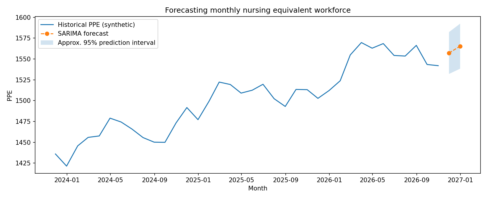
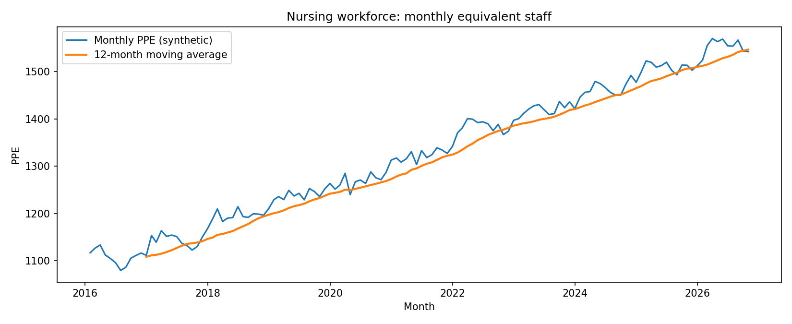
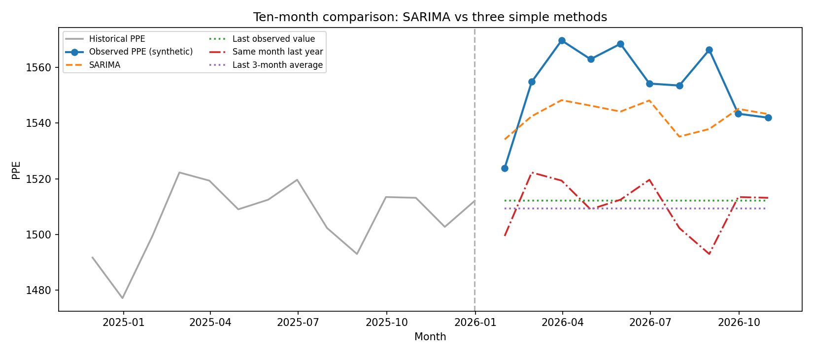

# Forecasting a hospital's nursing workforce with SARIMA

### A step-by-step, reproducible time-series forecasting project

Can we estimate the **monthly equivalent nursing workforce (PPE)** in a hospital using only its past values? This project explores that question with **SARIMA**, a seasonal time-series model, and tests whether it does better than three simple prediction rules.

The public data are **100% synthetic**, created solely for educational purposes. They do not represent any real hospital, contracts or workers. The performance figures below are illustrative, **not real-world validation**.



## 1. What is equivalent nursing workforce (PPE)?

Monthly PPE measures staffing volume adjusted for contract duration and working time. It is **not** the number of distinct employees.

For every nursing employment contract, calculate its contribution and add them all:

$$
\text{Monthly PPE}=\sum_{\text{contracts }c}\left(\frac{\text{Days contracted during the month}_c}{\text{Calendar days in the month}}\times\text{Working-time proportion}_c\right)
$$

For example, in a 30-day month, a full-time contract covering all 30 days contributes **1.00 PPE**. A half-time contract covering 15 days contributes **0.25 PPE**. Together they contribute **1.25 PPE**.

The downloadable example starts with *already aggregated, synthetic monthly PPE observations*. It contains no individual contracts or employee data.

## 2. Data and forecasting question

**Question:** Can we forecast nursing PPE for the next months from the monthly historical series alone?

The CSV `data/raw/nursing_workforce_synthetic.csv` has exactly two fields:

| Column | Description |
| --- | --- |
| `DATANOM` | Reference month (calendar month-end). |
| `PPE` | Monthly equivalent nursing workforce. |

The demonstration has **130 months, January 2016–October 2026**. It was generated using a reproducible script and contains an artificial long-term movement, annual patterns and random fluctuations. No additional variables are used for forecasting.

## 3. The three-step project

### Notebook 01 — Explore and prepare the series

`notebooks/01_data_preparation_eda.ipynb`

Check for missing or duplicate months; plot the PPE series and its 12-month moving average; explore trend, seasonality and autocorrelation; and save a clean monthly time series.



### Notebook 02 — Train SARIMA and compare methods

`notebooks/02_model_training_validation.ipynb`

Use **January 2016–December 2025 for training** and reserve the **last ten months (January–October 2026)** as unseen test data. Compare three SARIMA configurations using training-only AIC and evaluate the selected configuration on the held-out months.

Then compare SARIMA against three easy-to-explain methods. Each method predicts all ten test months **from the same historical cutoff**, without using actual test-period values:

| Method | How it forecasts |
| --- | --- |
| **SARIMA** | Uses past PPE values and recurring seasonal patterns. |
| **Last observed value** | Repeats the final PPE value from the training period. |
| **Same month last year** | Repeats the corresponding month from the preceding year. |
| **Last three-month average** | Repeats the mean of the final three observed training months. |

Evaluate with **MAE** (mean absolute error, measured in PPE units), RMSE and MAPE. Lower is better; the comparison matters more than a sophisticated algorithm's name.



### Notebook 03 — Forecast the next two months

`notebooks/03_future_forecast.ipynb`

Refit the selected SARIMA configuration on all 130 historical months, forecast **November and December 2026**, calculate approximate **95% model-based prediction intervals**, and export a CSV containing the SARIMA forecasts and all three simple alternatives.

## 4. Results on synthetic data

**Ten-month holdout evaluation:**

| Forecasting method | MAE (PPE) | RMSE (PPE) | MAPE |
| --- | ---: | ---: | ---: |
| **SARIMA** | **14.10** | **16.66** | **0.90%** |
| Last observed value | 41.82 | 43.98 | 2.68% |
| Same month last year | 43.49 | 45.98 | 2.79% |
| Last three-month average | 44.58 | 46.61 | 2.86% |

The winning synthetic-data model is **SARIMA(0,1,1) × (0,1,1,12)**, selected by AIC using training data only. It performs best in this **single** holdout exercise, but that is not a guarantee of future performance elsewhere.

**Two-month SARIMA forecast (illustrative only):**

| Month | Forecast PPE | Approximate 95% interval |
| --- | ---: | ---: |
| November 2026 | 1,557.11 | 1,532.00–1,582.23 |
| December 2026 | 1,565.36 | 1,538.32–1,592.39 |

These intervals depend on model assumptions; they are **not** guaranteed coverage, especially if staffing patterns change.

## 5. Run the project

From the repository root, use Python 3.11+:

```bash
python -m venv .venv
# Windows: .venv\Scripts\activate
# macOS / Linux: source .venv/bin/activate
python -m pip install -r requirements.txt
jupyter lab
```

Run the notebooks in order:

1. `notebooks/01_data_preparation_eda.ipynb`
2. `notebooks/02_model_training_validation.ipynb`
3. `notebooks/03_future_forecast.ipynb`

To regenerate the same synthetic dataset:

```bash
python scripts/generate_synthetic_data.py
```

To run the optional tests:

```bash
python -m pip install -r requirements-dev.txt
python -m pytest -q
```

The three notebooks are distributed with executed output cells based solely on the synthetic example. The locally trained model file is excluded from version control; execute notebooks 01 and 02 before notebook 03 when running the project yourself. **Only load model files that you created or fully trust.**

## 6. Repository layout

```text
nursing-workforce-forecasting-ts/
├── README.md
├── requirements.txt
├── requirements-dev.txt
├── data/
│   ├── raw/nursing_workforce_synthetic.csv
│   └── processed/                       # generated by notebook 01
├── notebooks/
│   ├── 01_data_preparation_eda.ipynb
│   ├── 02_model_training_validation.ipynb
│   └── 03_future_forecast.ipynb
├── scripts/generate_synthetic_data.py
├── src/ppe_forecasting.py
├── outputs/
│   ├── figures/                         # example plots
│   ├── reports/                         # metrics, predictions and forecasts
│   └── models/                          # local only; not uploaded
└── tests/test_pipeline.py
```

## 7. Limitations and next steps

This example uses simulated rather than observed hospital data, one ten-month holdout and one SARIMA setup chosen from three candidates. Historical patterns may fail after organizational or structural changes. Before any operational use, we would need **real aggregated data with authorization**, repeated time-series validation (rolling-origin backtesting), monitoring of forecast errors and a careful assessment of prediction intervals.

The lesson is simple: **always compare a complex forecasting model with understandable alternatives, and communicate uncertainty rather than only a point estimate.**

**Related project:** [Monthly maternity-leave forecasting with multiple linear regression](https://github.com/cmromero/maternity-leave-forecasting-mlr).
